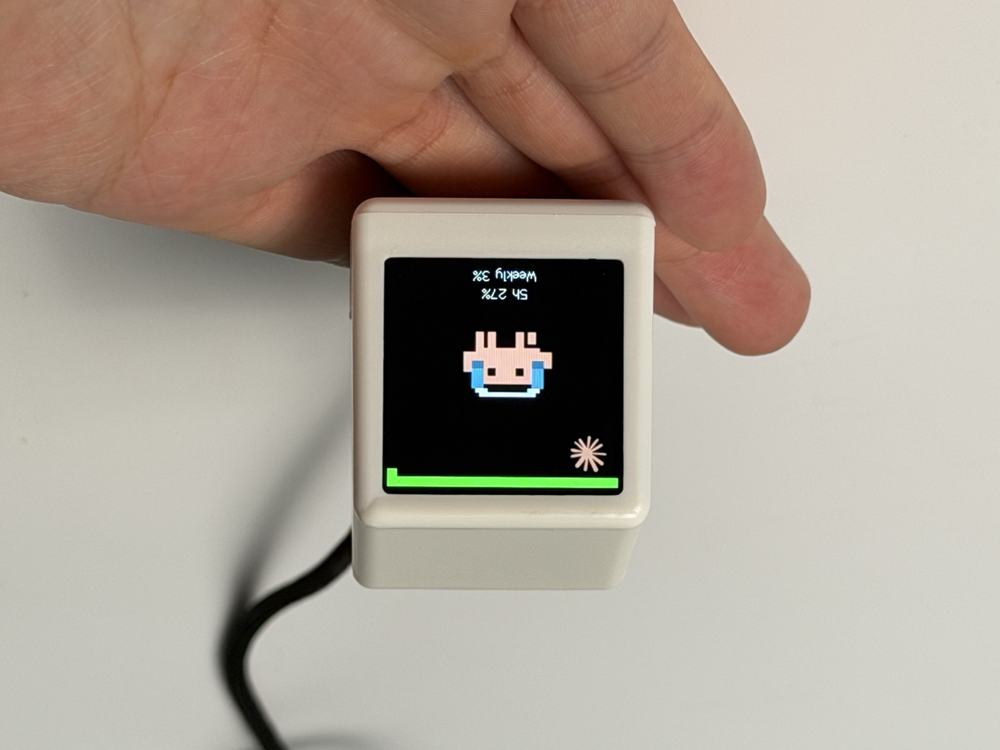
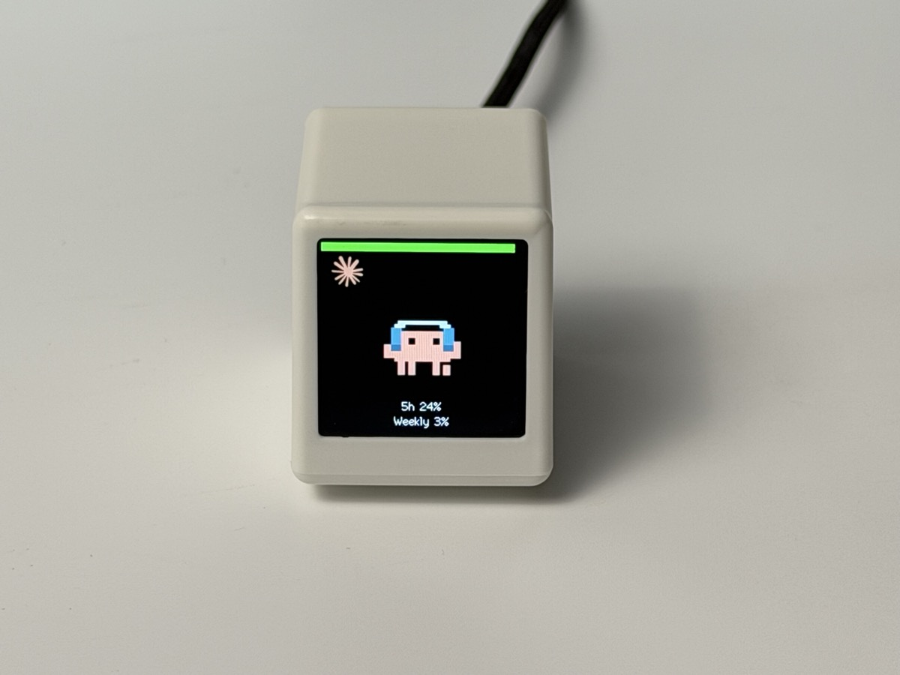
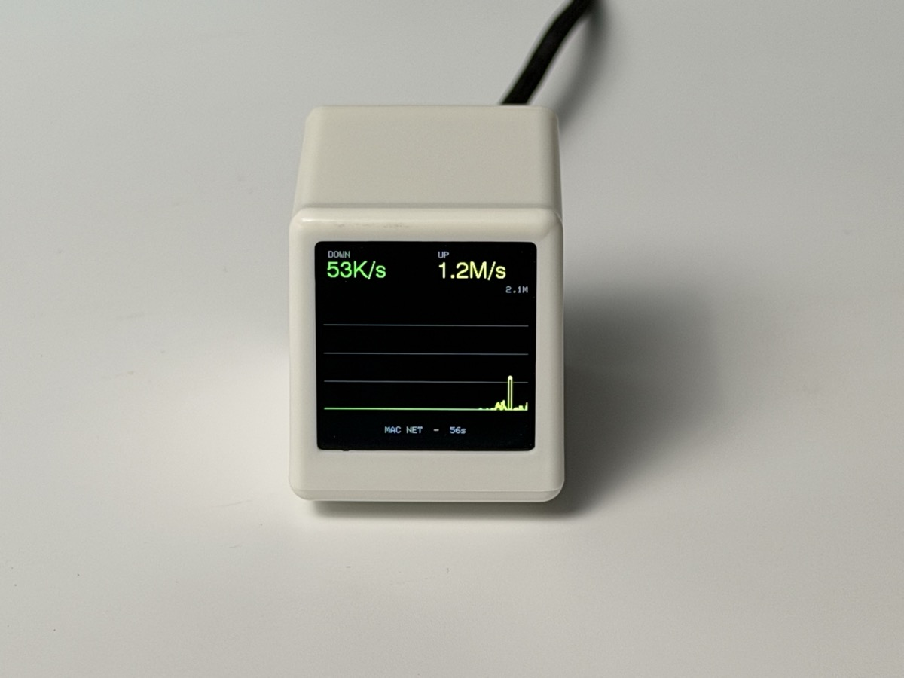
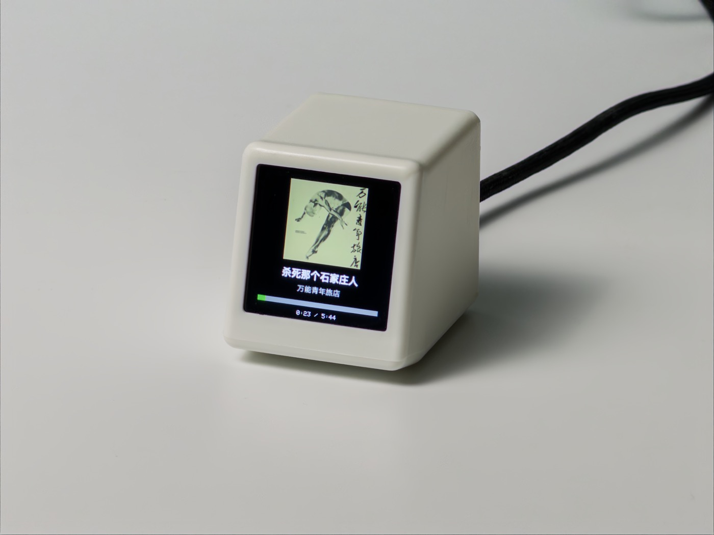
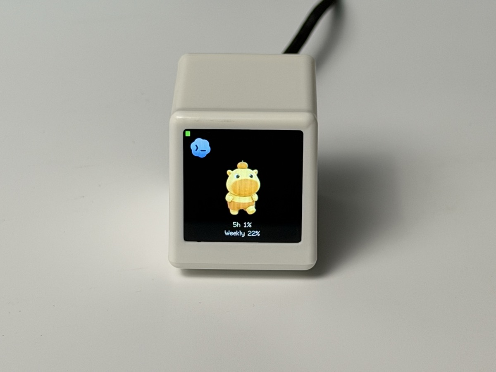
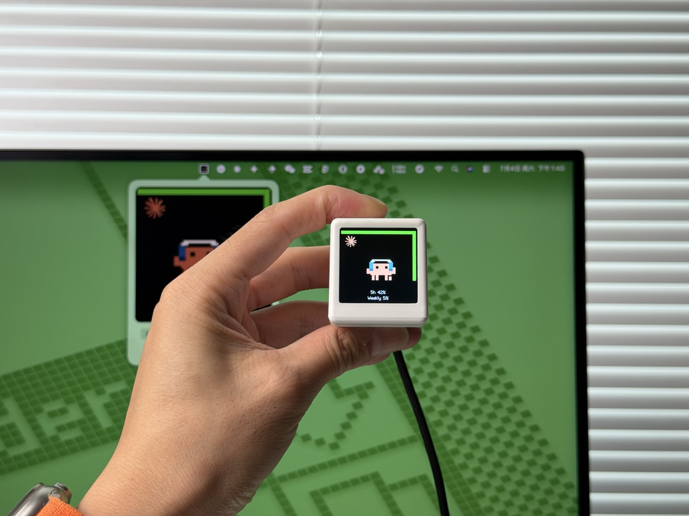

<p align="center">
  
</p>

<h1 align="center">AI Mac 小螢幕</h1>

<p align="center">桌上的一台 AI 狀態小電腦 —— ESP8266 · 開源硬體 · 桌面伴侶</p>

<p align="center">
  中文 ·
  <a href="README.en.md">English</a>
</p>

<p align="center">
  <a href="https://mac.qust.me">官網</a> ·
  <a href="https://mac.qust.me/#flash">網頁刷機</a> ·
  <a href="https://github.com/pengchujin/esp8266-ai/releases/latest">下載</a>
</p>

<p align="center">
  
</p>

一塊 240×240 的復古小電視，放在桌上實時顯示 **Claude Code / Codex CLI 在幹什麼、額度還剩多少**。不需要任何 API key：資料來自本機已有的 CLI 登入憑據和會話日誌，由配套的 Windows 橋接程式在區域網內提供給裝置。

## 功能

| | |
|---|---|
|  | **AI 工作狀態與額度**<br>桌寵動起來 = AI 正在幹活。方形進度環 + 大字顯示 5 小時 / 周額度的真實用量；額度用滿自動換成重置倒計時，等你審批時整圈邊框紅閃提醒。 |
|  | **網速實時監視**<br>工作管理員風格的上下行曲線，56 秒滾動視窗，量程自動調整。 |
|  | **音樂播放顯示**<br>專輯封面、歌名、歌手、進度條實時同步；音樂響起自動切入，停止自動切回。 |
|  | **可換桌寵**<br>內建 [petdex.dev](https://petdex.dev) 畫廊 3300+ 開源桌寵，也可上傳任意 GIF，裝置板上直接解碼，無需重燒韌體。 |

## 本分支新增功能

- **自動輪播**：系統匣右鍵 →「自動輪播」，自己勾選要輪播的頁面（Claude 額度 / Codex 額度 / 網速 / 音樂 / 股票），並設定每頁停留秒數
- **天氣預報頁**：台灣 22 縣市（預設高雄市，托盤右鍵 →「天氣城市」切換），顯示目前溫度、體感、濕度、降雨機率、風速與三日預報，資料來自 Open-Meteo（免 API key）。這一頁需要重新編譯並燒錄韌體（v0.4.12 以上）
- **台股與加密貨幣**：股票頁可顯示台股（`tw2330`）、美股（`usAAPL`）和加密貨幣（`ccBTC`、`ccETH`），移除了 A 股 / 港股
- 僅保留 Windows 橋接程式，介面與檔案改為繁體中文

## 快速上手

需要的東西：一台「SD2 小電視」開發板（[開源硬體](https://oshwhub.com/q21182889/sd2)，也可[直接購買成品](https://mobile.yangkeduo.com/goods.html?ps=OuBjGMWE82)）、一根 USB **資料**線。

### 第 1 步 · 刷韌體（約 30 秒）

用 Chrome / Edge 開啟 **[mac.qust.me/#flash](https://mac.qust.me/#flash)**，USB 連線裝置，點「連線裝置並燒錄」，選擇串列埠等待完成即可，無需安裝任何工具。

> 彈窗裡看不到串列埠？Windows 需要裝 [CH340 驅動](https://www.wch.cn/downloads/CH341SER_EXE.html)；換根 USB 線（很多線只能充電）；更多排查見[官網 FAQ](https://mac.qust.me/#flash-faq)。
>
> 命令列黨也可以用 esptool 把 [Releases](https://github.com/pengchujin/esp8266-ai/releases/latest) 裡的 `esp8266-ai-firmware-*.bin` 刷到 `0x0`。

### 第 2 步 · 配 WiFi

裝置首次開機會開熱點 **`AI-Clock-Setup`**：手機連上後自動彈出配網頁（沒彈就用瀏覽器開啟 `192.168.4.1`），選擇家裡 WiFi、輸入密碼，完成。

### 第 3 步 · 裝橋接程式

從 [Releases](https://github.com/pengchujin/esp8266-ai/releases/latest) 下載並開啟：

- **Windows**：`AIClockBridge-*-Windows-x64.exe`，雙擊即用

橋接程式常駐系統系統匣，會**自動發現並配對**同一區域網內的裝置——到這裡螢幕就活了。

<p align="center">
  
</p>

日常使用都在系統匣圖示上：**左鍵**開啟裝置畫面的實時映象（底部有螢幕亮度滑條），**右鍵**是完整選單（額度詳情、螢幕切換、更換桌寵、音樂/網速頁等）。

## 常見問題

- **螢幕邊框紅色閃爍**：裝置連不上橋接程式——確認電腦端程式在執行、和裝置在同一 WiFi。
- **額度一直顯示 `-`**：本機沒有登入過 Claude Code / Codex CLI，橋接程式讀不到憑據。
- **想換桌寵**：右鍵系統匣圖示 → 「更換桌寵動畫…」，挑一個點上傳就行。

## 開發

```
firmware/     ESP8266 韌體（PlatformIO + Arduino，含板上 GIF 解碼）
windows-app/  Windows 系統匣橋接（C# / .NET 8 WinForms）
tools/        GIF → RGB565 內建精靈圖轉換指令碼
docs/         開發文件（硬體引腳、HTTP API、架構細節）
```

```bash
cd firmware && pio run -t upload   # 韌體：編譯 + USB 燒錄
cd windows-app/AIClockBridge && dotnet run   # Windows 橋接：本地跑起來
```

硬體引腳表、螢幕驅動的坑、裝置 HTTP API、GIF 板上解碼架構等細節見 **[docs/DEVELOPMENT.md](docs/DEVELOPMENT.md)**。

硬體、韌體、軟體全部開源，拿去改、拿去做、拿去賣都行。
